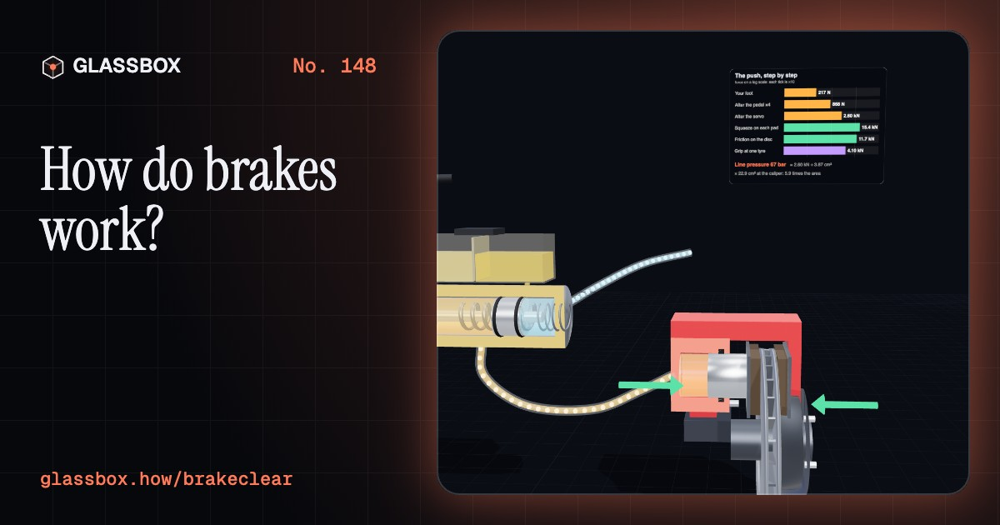
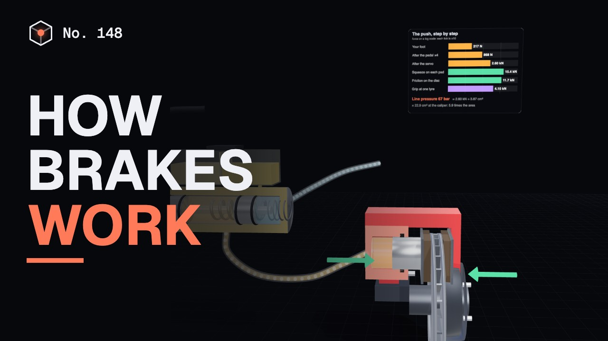
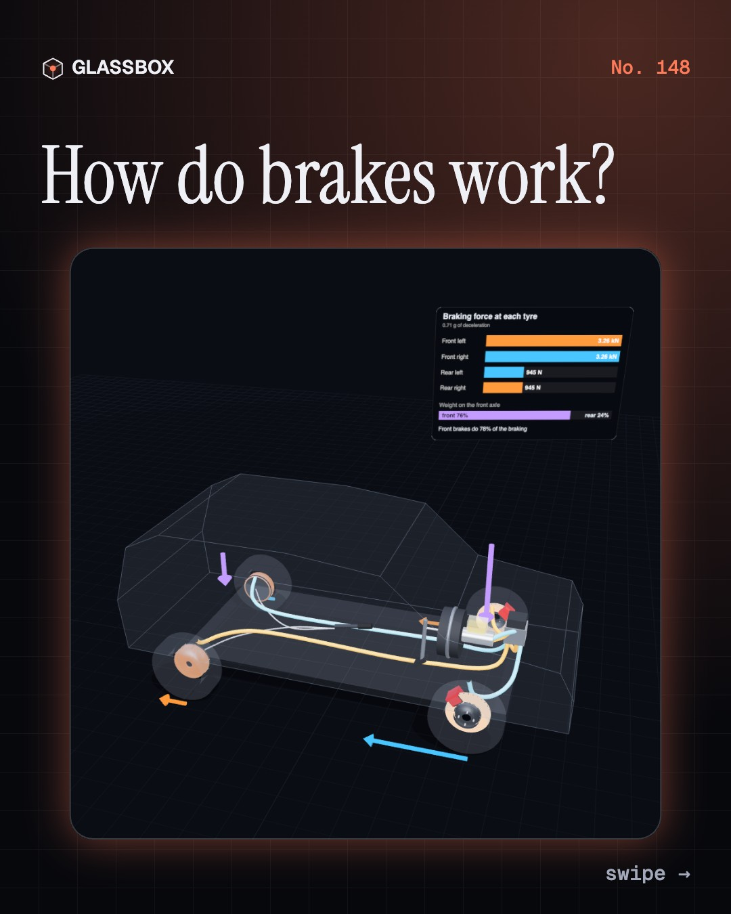
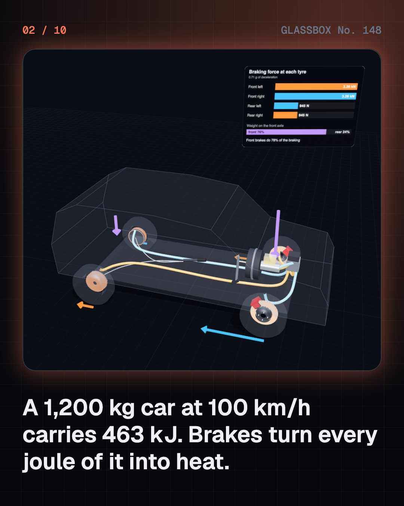
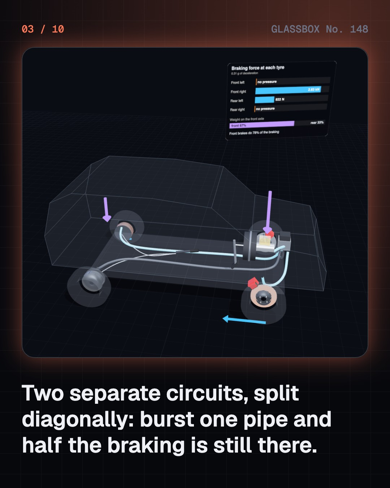
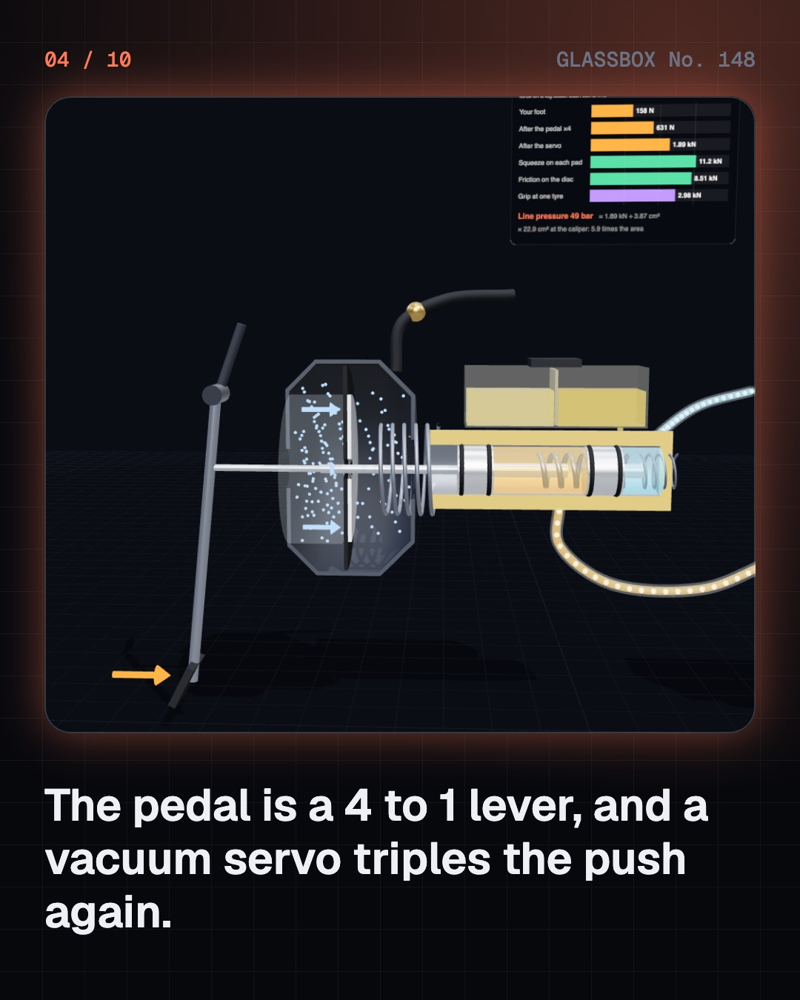

<!-- glassbox:start -->
<!-- Generated from glassbox.json by the Glassbox hub (npm run readme -- brakeclear). Edit glassbox.json, not this block. -->
<p align="center"><a href="https://glassbox.how/e/brakeclear/"></a></p>

<h1 align="center">BrakeClear</h1>

<p align="center"><b>How do brakes work?</b><br>Your foot pushes with 100 newtons and the pads squeeze with 7,000. Follow the push through a lever, a vacuum servo and Pascal's law, watch a disc soak up the heat of a stop, and see ABS catch a locking wheel on a wet road.</p>

<p align="center"><a href="https://glassbox.how/brakeclear/"><b>▶ Play with it</b></a> &nbsp;·&nbsp; <a href="https://glassbox.how/e/brakeclear/">Read the 60-second explainer</a> &nbsp;·&nbsp; <a href="https://glassbox.how/brakeclear/glassbox/reel.mp4">Watch the 40-second video</a></p>

<p align="center">
  <a href="https://glassbox.how/e/brakeclear/"></a>
  <a href="https://glassbox.how/e/brakeclear/"></a>
  <a href="LICENSE"></a>
  <a href="LICENSE-CONTENT.md"></a>
  <a href="#privacy"></a>
</p>

## In 60 seconds

1. **Brakes turn motion into heat.** A 1,200 kg car at 100 km/h carries 463 kJ of kinetic energy. To stop, all of it must go somewhere, and brakes rub it away as heat. One pedal works four brakes through two separate circuits of fluid, split diagonally, so a burst pipe still leaves half the braking.
2. **A 100 N push becomes 7 kN.** The pedal is a 4 to 1 lever. A vacuum servo triples the push by letting air press on a diaphragm. The master cylinder turns 1,200 N into 31 bar of pressure, and by Pascal's law the same pressure reaches a caliper piston with six times the area: 7.1 kN on each pad.
3. **Discs pinch, drums push out.** A floating caliper has one piston but squeezes the disc from both sides, and its square rubber seal pulls the pads clear again. In a drum, the leading shoe is dragged into the drum and grips itself harder. That free help makes drums lose more grip than discs when their linings get hot.
4. **Heat is the limit.** One hard stop from 100 km/h warms each 5 kg front rotor by about 65 °C. Stop again and again, or ride the brakes down a long hill, and the pads pass 300 °C and fade. Hotter still, the brake fluid can boil and the pedal goes soft. A low gear lets the engine take the load instead.
5. **A tyre grips best while it still turns.** Grip peaks at about 10 to 20% slip. A locked wheel slides, grips less and cannot steer at all. ABS watches each wheel with a toothed ring and a sensor, and holds, releases and re-applies the pressure several times a second to keep the tyre near its peak.
6. **Air that fails safe, motors that give back.** Trucks and buses brake with compressed air, and a strong spring in each chamber applies the brakes if the air is lost. An electric car brakes with its motor working as a generator, putting energy back in the battery, and blends in friction brakes for the rest.

## Words worth knowing

| Term | Meaning |
|---|---|
| **Kinetic energy** | The energy of motion, ½ × mass × speed². Double the speed and there is four times as much to turn into heat. |
| **Master cylinder** | The pump under the pedal that turns your push into pressure in the brake fluid. It has two pistons, one for each circuit. |
| **Pascal's law** | Pressure put on a trapped fluid reaches every part of it equally, so a bigger piston gets a bigger force. |
| **Vacuum servo** | A diaphragm with engine vacuum on one side. Letting air in behind it adds to the driver's push, about three times over. |
| **Floating caliper** | A disc-brake clamp with a piston on one side only. Its body slides so both pads squeeze the disc equally. |
| **Leading shoe** | A drum-brake shoe that the turning drum drags into harder contact, so it multiplies its own grip. |
| **Brake fade** | Brakes working less well when very hot, because the friction of the pads or linings falls. |
| **Slip** | How much slower a braked tyre's tread moves than the road. Grip is highest at about 10 to 20% slip and lower when the wheel is locked. |
| **ABS** | Anti-lock braking system. It senses a wheel about to lock and briefly lowers that brake's pressure, so the tyre keeps gripping and steering. |

## A short history

**200 years from a block of wood on a cartwheel to cars that brake by themselves.**

- **1869** · Air stops a train (George Westinghouse, Pittsburgh, Pennsylvania, USA)
- **1902** · The disc brake is patented (Frederick W. Lanchester, Birmingham, England)
- **1917** · Fluid in place of rods (Malcolm Loughead (later spelled Lockheed), Santa Barbara, California, USA)
- **1953** · Disc brakes win Le Mans (Tony Rolt and Duncan Hamilton, Jaguar and Dunlop, Le Mans, France)
- **1968** · Two circuits, by law (U.S. Department of Transportation, Washington, D.C., USA)
- **1978** · Electronic ABS goes on sale (Bosch and Mercedes-Benz, Stuttgart-Untertürkheim, Germany)
- **1995** · Braking one wheel to stop a skid (Bosch and Mercedes-Benz, Germany)
- **1997** · Braking that refills the battery (Toyota, Toyota City, Japan)

The full story, with 30 moments, charts, people and 45 sources: [glassbox.how/e/brakeclear/history](https://glassbox.how/e/brakeclear/history/). The data lives in [`history.json`](history.json).

## Video and slides

Made with the Glassbox studio from this box's storyboard (`window.glassbox.director`). Free to reuse under CC BY 4.0.

<a href="https://glassbox.how/brakeclear/glassbox/video.mp4"></a>

<p><a href="glassbox/slide-1.jpg"></a> <a href="glassbox/slide-2.jpg"></a> <a href="glassbox/slide-3.jpg"></a> <a href="glassbox/slide-4.jpg"></a></p>

| File | What | Size |
|---|---|---|
| [`glassbox/reel.mp4`](https://glassbox.how/brakeclear/glassbox/reel.mp4) | Reel / Short, with captions and soundtrack | 1080×1920 |
| [`glassbox/video.mp4`](https://glassbox.how/brakeclear/glassbox/video.mp4) | YouTube video, with captions and soundtrack | 1920×1080 |
| `glassbox/slide-1…10.jpg` | Instagram carousel | 1080×1350 |
| `glassbox/thumb.jpg` | YouTube thumbnail | 1280×720 |
| `glassbox/cover.jpg` | Share card and repo social preview | 1200×630 |
| [`glassbox/history-reel.mp4`](https://glassbox.how/brakeclear/glassbox/history-reel.mp4) | “History in 10 moments” Reel / Short | 1080×1920 |
| `glassbox/history-slide-*.jpg` | History carousel | 1080×1350 |
| `glassbox/post.json` | Post copy and schedule used by the publish kit | |

## Privacy

This box has no accounts and no ads, and it ships its own fonts and libraries. When you run it yourself it sends nothing anywhere. On glassbox.how, the site's `/bar.js` also loads Glassbox's analytics: **Google Analytics** to count visits (it asks first in the EU, UK and Switzerland, and stays off when your browser sends Global Privacy Control or Do Not Track) and **ClickTrust** to detect bots.

It remembers a few things **in your own browser only**, and never sends them anywhere:

| Browser storage key | What it holds |
|---|---|
| `brakeclear.v1` | Which chapters you have opened, your best quiz scores, and sound on or off. |

Exactly what each one sees is at [glassbox.how/privacy](https://glassbox.how/privacy/).

## Licences

- **Code:** [MIT](LICENSE). Use it, change it, ship it.
- **Explanations, text, images and videos** (`glassbox.json`, `glassbox/`): [CC BY 4.0](LICENSE-CONTENT.md). Credit “Glassbox, glassbox.how/e/brakeclear”.
- **Third-party parts** keep their own licences: [three.js](https://threejs.org) (MIT), [Geist, Instrument Serif](https://openfontlicense.org) (SIL OFL 1.1).
- The Glassbox name and logo aren't covered by either licence. See the [terms](https://glassbox.how/terms/).

Found a mistake? [Open an issue](https://github.com/bdeeps/brakeclear/issues). Corrections happen in public.
<!-- glassbox:end -->

## Run it

It's plain HTML, CSS and JavaScript. No build step and no dependencies. Run locally, it contacts no other website.

```bash
python3 -m http.server 8000
```

Three.js and the fonts ship in `vendor/` and `fonts/`, so it also works offline.

Then open http://localhost:8000.

## How it's built

| File | What |
|---|---|
| `index.html`, `css/app.css` | The page and its styles |
| `js/app.js`, `js/stage.js`, `js/ui.js`, `js/kit.js` | The shared Glassbox 3D engine: chapters, 3D stage, controls, quiz, video director |
| `js/brake.js` | BrakeClear's own physics and parts: the foot-to-pad force chain, drum shoe factors, rotor heat, brake fluid, the tyre slip curve and ABS wheel simulation, air and regenerative brakes, plus the 3D rotor, drum and cut-away helpers and chart boards |
| `js/chapters/*.js` | One file per chapter: the 3D model, controls, text, key terms, quiz and video scenes |
| `glassbox.json` | Title, question, explainer beats, key terms, browser storage and credits shown on glassbox.how |
| `reel` in each chapter | The storyboard the Glassbox studio records into short videos |
| `glassbox/` | The published video, slides, thumbnail and post copy |
| `fonts/`, `vendor/three/` | Self-hosted Geist and Instrument Serif (SIL OFL 1.1) and three.js (MIT) |
